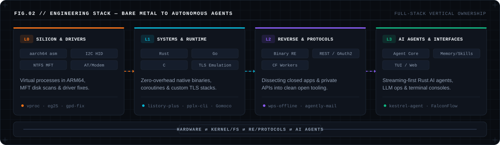
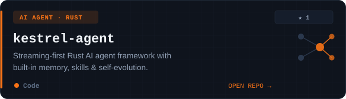
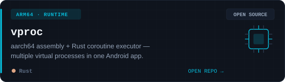
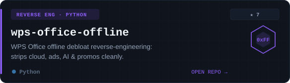
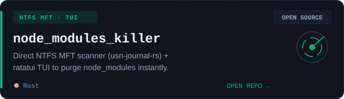
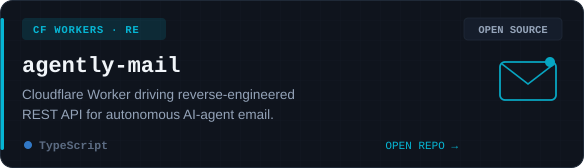
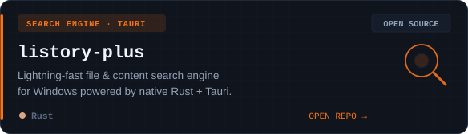

  <picture>
    <source media="(prefers-color-scheme: dark)" srcset="./assets/hero-dark.svg" />
    <source media="(prefers-color-scheme: light)" srcset="./assets/hero-light.svg" />
    
  </picture>

 

  <picture>
    <source media="(prefers-color-scheme: dark)" srcset="./assets/architecture-dark.svg" />
    <source media="(prefers-color-scheme: light)" srcset="./assets/architecture-light.svg" />
    
  </picture>

 

### `FIG.04 // SELECTED ENGINEERING ARTIFACTS`

  <a href="https://github.com/Bahtya/kestrel-agent">
    <picture>
      <source media="(prefers-color-scheme: dark)" srcset="./assets/card-kestrel-agent-dark.svg" />
      <source media="(prefers-color-scheme: light)" srcset="./assets/card-kestrel-agent-light.svg" />
      
    </picture>
  </a>
  <a href="https://github.com/Bahtya/vproc">
    <picture>
      <source media="(prefers-color-scheme: dark)" srcset="./assets/card-vproc-dark.svg" />
      <source media="(prefers-color-scheme: light)" srcset="./assets/card-vproc-light.svg" />
      
    </picture>
  </a>
   
  <a href="https://github.com/Bahtya/wps-office-offline">
    <picture>
      <source media="(prefers-color-scheme: dark)" srcset="./assets/card-wps-office-offline-dark.svg" />
      <source media="(prefers-color-scheme: light)" srcset="./assets/card-wps-office-offline-light.svg" />
      
    </picture>
  </a>
  <a href="https://github.com/Bahtya/node_modules_killer">
    <picture>
      <source media="(prefers-color-scheme: dark)" srcset="./assets/card-node_modules_killer-dark.svg" />
      <source media="(prefers-color-scheme: light)" srcset="./assets/card-node_modules_killer-light.svg" />
      
    </picture>
  </a>
   
  <a href="https://github.com/Bahtya/agently-mail">
    <picture>
      <source media="(prefers-color-scheme: dark)" srcset="./assets/card-agently-mail-dark.svg" />
      <source media="(prefers-color-scheme: light)" srcset="./assets/card-agently-mail-light.svg" />
      
    </picture>
  </a>
  <a href="https://github.com/Bahtya/listory-plus">
    <picture>
      <source media="(prefers-color-scheme: dark)" srcset="./assets/card-listory-plus-dark.svg" />
      <source media="(prefers-color-scheme: light)" srcset="./assets/card-listory-plus-light.svg" />
      
    </picture>
  </a>

 

  <picture>
    <source media="(prefers-color-scheme: dark)" srcset="./assets/telemetry-dark.svg" />
    <source media="(prefers-color-scheme: light)" srcset="./assets/telemetry-light.svg" />
    
  </picture>

 

<code>▸ MORE INSTRUMENTS, HARDWARE FIXES &amp; TOOLING (6)</code>

 

| Artifact | Stack | Focus |
| :--- | :--- | :--- |
| [**`eg25-manager`**](https://github.com/Bahtya/eg25-manager) | `TypeScript` | Desktop controller for Quectel EG25-G cellular modem (SMS, voice, GPS, USSD, data) |
| [**`pplx-cli`**](https://github.com/Bahtya/pplx-cli) | `Rust` | CLI client for Perplexity AI web API with Chrome 136 TLS fingerprint emulation |
| [**`dynamic-thread-pool`**](https://github.com/Bahtya/dynamic-thread-pool) | `Java` | Dynamic thread pool control plane + LLM Ops Agent (+ [Spring Boot SDK](https://github.com/Bahtya/dynamic-thread-pool-sdk)) |
| [**`gpd-win-max2-touchpad-fix`**](https://github.com/Bahtya/gpd-win-max2-touchpad-fix) | `PowerShell` / `Shell` | Goodix GXTP7385 touchpad fixes for GPD WIN Max2 ([Windows](https://github.com/Bahtya/gpd-win-max2-touchpad-fix) &amp; [Linux I2C HID](https://github.com/Bahtya/gpd-winmax2-touchpad-fix)) |
| [**`Gomoco`**](https://github.com/Bahtya/Gomoco) | `Go` | Lightweight Mock Server inspired by Moco with clean Web UI |
| [**`FalconFlow`**](https://github.com/Bahtya/FalconFlow) | `TypeScript` | Modern PT-friendly qBittorrent console with tracker analytics, IO telemetry &amp; auto check-in |

 

  <picture>
    <source media="(prefers-color-scheme: dark)" srcset="./assets/footer-dark.svg" />
    <source media="(prefers-color-scheme: light)" srcset="./assets/footer-light.svg" />
    
  </picture>

